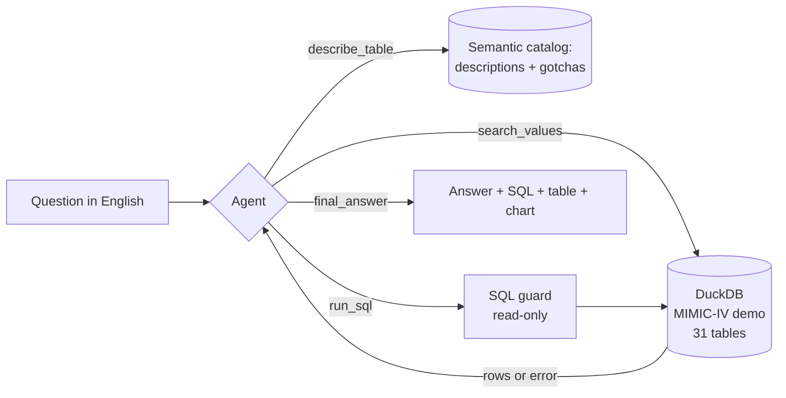
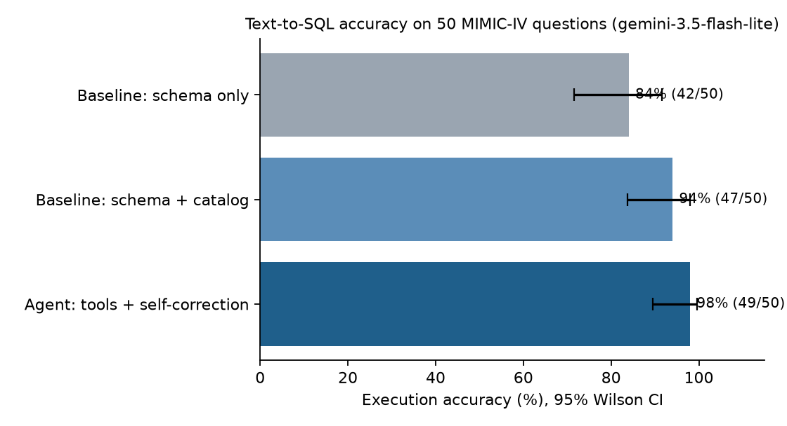

# Clinical SQL Agent

Ask questions about hospital data in plain English. An LLM agent explores a 31-table clinical
database, writes read-only SQL, runs it, fixes its own mistakes and answers, and a 50-question
benchmark measures how often it is actually right.

<!-- After deploying, replace the link below with your Streamlit URL -->
[](https://share.streamlit.io)

> **Results** (50 questions, Gemini 3.5 Flash Lite): the agent answered **49/50 correctly (98%)**,
> vs **94%** when the model is given the documented schema in one shot and **84%** with the raw schema
> only. Most of the gain comes from documenting the data; the agent adds the rest at ~3.7x the model calls.

## Why this project
Clinicians, managers and analysts constantly need numbers from the EHR ("what's our mortality by
insurance?", "how many ICU stays involved ventilation?"), and each one usually waits for someone who
knows SQL and the schema. LLMs can write SQL, but clinical databases are full of traps that produce
answers that *look* right and are wrong. This project builds an agent for that job and, more
importantly, **measures it**: execution accuracy against hand-checked gold queries, compared with
two simpler approaches, with a full list of every miss.

## What it does


Three approaches are compared on the same 50 questions:

| Approach | What the model gets | LLM calls |
|---|---|---|
| **Baseline: schema only** | `CREATE TABLE` statements for all 31 tables, one shot | 1 |
| **Baseline: schema + catalog** | Every table documented: column meanings, valid values, join rules and known traps, one shot | 1 |
| **Agent** | A table overview plus four tools: `describe_table`, `search_values`, `run_sql`, `final_answer`. It looks things up, runs drafts, reads errors and results, and fixes its query | 3-8 |

## Data
[MIMIC-IV Clinical Database Demo v2.2](https://physionet.org/content/mimic-iv-demo/2.2/): real
de-identified records of 100 patients at Beth Israel Deaconess Medical Center: 275 admissions,
140 ICU stays, 107k lab results, 669k ICU charted measurements, 18k prescriptions. ODbL license,
included in `data/raw/` unchanged. See `data/README.md` for citations.

The data is full of the traps that break naive text-to-SQL, found while profiling it:

| Trap | Why naive SQL gets it wrong |
|---|---|
| ICD codes exist in versions 9 and 10 | Joining diagnoses to their names on `icd_code` alone matches wrong diagnoses (493 codes exist in both versions) |
| Lab names repeat | "Glucose" is 3 different tests (chemistry, blood gas, urine); "Creatinine" has 2 itemids |
| DRG codes come in two systems | Each admission has an HCFA row *and* an APR row, so counts double |
| Microbiology has one row per antibiotic tested | Counting rows counts antibiotics, not organisms; `CANCELLED` appears as an organism name |
| Age is stored as `anchor_age` in an `anchor_year` | Age at admission has to be derived |
| Dates are shifted to 2110-2201 | Calendar-year questions are meaningless |
| Outpatient measurements are text | BMI and weight need casting |

`src/catalog.yaml` documents all of this. Every claim in it was checked against the data.

## Evaluation design
- **50 questions** (`src/evaluation/questions.yaml`) across 5 categories (lookup 3, aggregation 19,
  dictionary lookups 8, clinical logic 10, multi-step 10) and 3 difficulty levels (12 easy, 24 medium,
  14 hard), each with a hand-written gold SQL query. All gold results are in `reports/gold_answers.md`.
- Questions are worded to have **exactly one correct answer**: top-N lists stop before ties, and
  rounding and units are stated.
- **Scoring = execution accuracy**: the model's query is run and its result compared with the gold
  result. Column names, column order and extra columns don't matter; row order only matters for
  rankings; whole numbers must match exactly; decimals within rounding (`src/evaluation/compare.py`).
- 95% Wilson confidence intervals; paired comparison on the same questions; every miss listed with
  its reason (wrong result, SQL error, no usable SQL).
- Runs are **resumable**: results are saved per question, so a free-tier quota stop costs nothing.

## Results
Model: **Gemini 3.5 Flash Lite** (free tier), temperature 0, one run. Full output: `reports/RESULTS.md`;
raw log of every answer: `reports/runs/gemini-3.5-flash-lite/results.jsonl`.



| Approach | Correct | Accuracy (95% CI) | Easy (12) | Medium (24) | Hard (14) | Model calls / question |
|---|---|---|---|---|---|---|
| Baseline: schema only | 42/50 | **84%** (71-92%) | 100% | 83% | 71% | 1 |
| Baseline: schema + catalog | 47/50 | **94%** (84-98%) | 100% | 96% | 86% | 1 |
| **Agent: tools + self-correction** | **49/50** | **98%** (90-100%) | 100% | 96% | **100%** | 3.7 |

| Category | Schema only | + Catalog | Agent |
|---|---|---|---|
| Aggregation (19) | 100% | 100% | 100% |
| Lookup (3) | 100% | 100% | 100% |
| Dictionary lookups (8) | 75% | 100% | 100% |
| Clinical logic (10) | **50%** | 90% | 90% |
| Multi-step (10) | 90% | 80% | **100%** |

**Paired comparison on the same questions (exact McNemar test):**
- Agent vs schema only: the agent was right on 7 questions the baseline missed, and wrong on none it got right (p = 0.016).
- Agent vs catalog baseline: 2 vs 0 (p = 0.50). **Not significant with 50 questions.**
- Catalog vs schema only: 6 vs 1 (p = 0.13).

### What the results say
1. **Documenting the data matters more than the agent.** Adding the semantic catalog (column
   meanings, valid values, join rules, traps) lifted clinical-logic questions from 50% to 90%. Easy
   and aggregation questions were never the problem; domain traps were.
2. **The agent helps most on hard, multi-step questions** (100% vs 86% on hard), because it runs
   drafts, reads the result and fixes them. That costs about 3.7 model calls and ~18 s per question
   instead of 1 call and ~5 s. Whether that's worth it depends on how costly a wrong number is.
3. **Free-text matching is the main failure mode.** Most misses came from `LIKE '%...%'` matching
   more than intended:
   - `'%invasive ventilation%'` also matches "**Non**-invasive ventilation" (66 stays instead of 60)
   - `'%lactate%'` includes lactate **dehydrogenase** (max 16,200 instead of 13.2)
   - `'%heart rate%'` includes the heart-rate **alarm** settings
   - `'%creatinine%'` / `'%potassium%'` without a fluid filter include **urine** tests
4. **The one question nobody got right (q34, invasive ventilation)** shows each approach's weak spot:
   the schema-only model wrote SQL that didn't parse, the catalog model fell for the "Non-invasive"
   match, and the agent found the right count (60, on its 4th of 11 queries) but kept exploring other
   tables for an alternative definition, hit its 8-step limit, and the fallback returned its last
   (empty) exploratory query. A smarter fallback that keeps the best query, not the last, would fix it.

### Benchmark revisions (after run 1)
All 18 misses were reviewed by hand: 11 were real model mistakes, and 7 (across four questions) were caused by problems with the benchmark, not the model.
They were fixed, and answers were re-scored offline (`python -m src.evaluation.rescore`, no API
calls) or the affected questions rerun for **all three** approaches:
- **q29:** the gold query counted only one of the two blood potassium tests; widened to both.
- **q36, q44:** correct answers were marked wrong because of output shape or labels; the expected
  format is now stated in the question, and both were rerun for every approach.
- **q18:** a correct query was rejected because the model wrote a stray `sql` line; the SQL cleaner
  now handles it (regression test added).

Before the revisions the scores were 82% / 90% / 92%. Original results are kept in
`results.before_rescore.jsonl`.

### Caveats
- One run of one small model: answers vary slightly between runs (on the rerun, the catalog
  baseline invented a column name on q44). Repeating runs or adding models would tighten the picture.
- 50 questions gives wide confidence intervals; the agent-vs-catalog difference is not significant.

## Safety
The model can never change or leak data. Three independent layers:
1. **SQL guard** (`src/db.py`): the query must parse (sqlglot) as exactly one `SELECT`/`WITH`
   statement; DDL/DML, `COPY`, `ATTACH`, `PRAGMA` and file-reading functions are rejected.
2. **Read-only database connection** with DuckDB external access disabled (no local files or URLs).
3. **Timeout** (20 s) and a **row cap** (500 returned, 20 shown to the model).

Tested in `tests/test_core.py` with 13 attack queries.

## Engineering notes (what broke and how it was fixed)
- **Google's new `AQ.` API keys** don't reliably work through Gemini's OpenAI-compatible
  endpoint, so the client calls the **native** `generateContent` REST API with the
  `x-goog-api-key` header (`src/llm/gemini.py`).
- **Thought signatures.** Newer Gemini models attach a signature to each function call that must
  be sent back unchanged in the next turn. The client stores the model's turns exactly as returned.
  A mock Gemini server (`tests/mock_gemini.py`) checks this, and the test fails if signatures are dropped.
- **Free-tier limits**: a shared rate limiter, retries honouring the API's `retryDelay`, and a clean
  stop on daily-quota errors so the evaluation can resume the next day.
- **Answer-key ambiguity**: building the gold set exposed ties in top-N lists (e.g. ranks 3-6 of
  primary diagnoses are tied), so those questions were narrowed until the answer was unique.
- **Free-tier model choice**: the newest Flash models allowed only 20 requests/day on the free tier
  (the evaluation needs ~350) or returned 503 "high demand", so the run used Gemini 3.5 Flash Lite
  (500/day). The evaluation is resumable, and the provider and model are one setting.
- **pandas 3**: missing values come back as NaN instead of None; the report code handles both.

## Run it
```bash
pip install -r requirements.txt
cp .env.example .env                 # then paste your API key into .env
python -m scripts.check_llm          # checks key, model, tool calling
python -m src.evaluation.run_eval    # 50 questions x 3 approaches (resumable)
streamlit run app.py                 # the app
python -m pytest -q                  # 42 tests, no API key needed
```
Works with Gemini (default, free tier) or any OpenAI-compatible API (Groq, OpenAI, Ollama...)
by changing `LLM_PROVIDER` in `.env`.

## Repo map
```
app.py                     Streamlit app (Ask / Evaluation / Data guide)
src/catalog.yaml           semantic layer: table and column meanings, join rules, traps
src/db.py                  SQL guard + read-only execution with timeout
src/llm/                   Gemini native client, OpenAI-compatible client, shared types
src/agent/                 prompts, tools, baselines and agent loop
src/evaluation/            questions + gold SQL, scoring, runner, report, rescore
scripts/check_llm.py       verifies your key and model
tests/                     42 tests incl. a mock Gemini server
reports/                   RESULTS.md, gold_answers.md, figures, raw run logs
data/raw/                  MIMIC-IV demo files (ODbL)
```

## Limitations
- 100 patients: fine for testing SQL skill, not for clinical conclusions.
- 50 questions is a small benchmark; the confidence intervals are wide, and they are reported.
- Questions were written by the author, who also wrote the catalog; a fresh set written by
  clinicians would be a stronger test.
- Not for clinical use.
