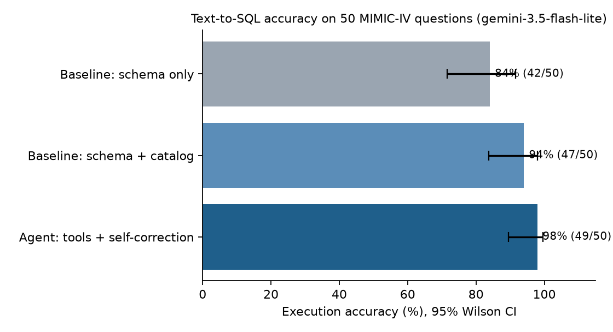

# Evaluation results (auto-generated, do not edit)

Run: `gemini-3.5-flash-lite` | model: **gemini-3.5-flash-lite** | questions per config: Baseline: schema only 50, Baseline: schema + catalog 50, Agent: tools + self-correction 50

| Config | Accuracy (95% CI) | Correct | Wrong result | SQL error | No usable SQL | Avg LLM calls | Avg SQL runs | Avg input tokens | Median seconds |
|---|---|---|---|---|---|---|---|---|---|
| Baseline: schema only | 84% (71%-92%) | 42/50 | 7 | 1 | 0 | 1.0 | 1.0 | 2,998 | 4.8 |
| Baseline: schema + catalog | 94% (84%-98%) | 47/50 | 2 | 1 | 0 | 1.0 | 1.0 | 6,017 | 5.0 |
| Agent: tools + self-correction | 98% (90%-100%) | 49/50 | 1 | 0 | 0 | 3.7 | 2.7 | 9,034 | 17.6 |

## By difficulty

| Difficulty | Baseline: schema only | Baseline: schema + catalog | Agent: tools + self-correction |
|---|---|---|---|
| easy | 100% | 100% | 100% |
| medium | 83% | 96% | 96% |
| hard | 71% | 86% | 100% |

## By category

| Category (n) | Baseline: schema only | Baseline: schema + catalog | Agent: tools + self-correction |
|---|---|---|---|
| aggregation (19) | 100% | 100% | 100% |
| clinical_logic (10) | 50% | 90% | 90% |
| dictionary (8) | 75% | 100% | 100% |
| lookup (3) | 100% | 100% | 100% |
| multi_step (10) | 90% | 80% | 100% |

## Paired comparison (same questions)

| Agent vs | Agent right, baseline wrong | Baseline right, agent wrong | Both right | Both wrong |
|---|---|---|---|---|
| Baseline: schema only | 7 | 0 | 42 | 1 |
| Baseline: schema + catalog | 2 | 0 | 47 | 1 |

## Every miss

| Question | Config | Outcome | Detail |
|---|---|---|---|
| q27 What is the average blood creatinine result in mg/dL, rounded to two d | baseline_schema | wrong result | returned 1.0 row(s): [{"avg_creatinine": 8.61}] |
| q29 What percentage of blood potassium results were flagged abnormal? Roun | baseline_schema | wrong result | returned 1.0 row(s): [{"abnormal_percentage": 11.2}] |
| q34 How many ICU stays included invasive ventilation? | agent | wrong result | returned 0.0 row(s): [] |
| q34 How many ICU stays included invasive ventilation? | baseline_catalog | wrong result | returned 1.0 row(s): [{"invasive_ventilation_icu_stays": 66}] |
| q34 How many ICU stays included invasive ventilation? | baseline_schema | SQL error | Rejected: Could not parse SQL: Invalid expression / Unexpected token. Line 10, Col: 1. |
| q36 For E. coli, how many ciprofloxacin susceptibility results were resist | baseline_schema | wrong result | returned 0.0 row(s): [] |
| q37 Which organism was found in the most distinct urine culture specimens, | baseline_schema | wrong result | returned 0.0 row(s): [] |
| q39 What is the average BMI recorded in the outpatient measurements, round | baseline_schema | wrong result | returned 1.0 row(s): [{"avg_bmi": null}] |
| q40 What was the highest blood lactate value recorded, and for which patie | baseline_schema | wrong result | returned 1.0 row(s): [{"subject_id": 10029291, "highest_lactate_value": 16200.0}] |
| q42 What is the average ICU heart rate for each first care unit, rounded t | baseline_catalog | wrong result | returned 9.0 row(s): [{"first_careunit": "Coronary Care Unit (CCU)", "avg_heart_rate": 99.9}, {"first_careunit": "Medical/Surgical Intensive Care Unit (MICU/SICU)", "avg_heart_rate" |
| q42 What is the average ICU heart rate for each first care unit, rounded t | baseline_schema | wrong result | returned 9.0 row(s): [{"first_careunit": "Coronary Care Unit (CCU)", "avg_heart_rate": 99.9}, {"first_careunit": "Medical/Surgical Intensive Care Unit (MICU/SICU)", "avg_heart_rate" |
| q44 Compare the average hospital length of stay in days (rounded to two de | baseline_catalog | SQL error | Binder Error: Table "a" does not have a column named "admitted_time_alias"  Candidate bindings: : "admittime"  |
